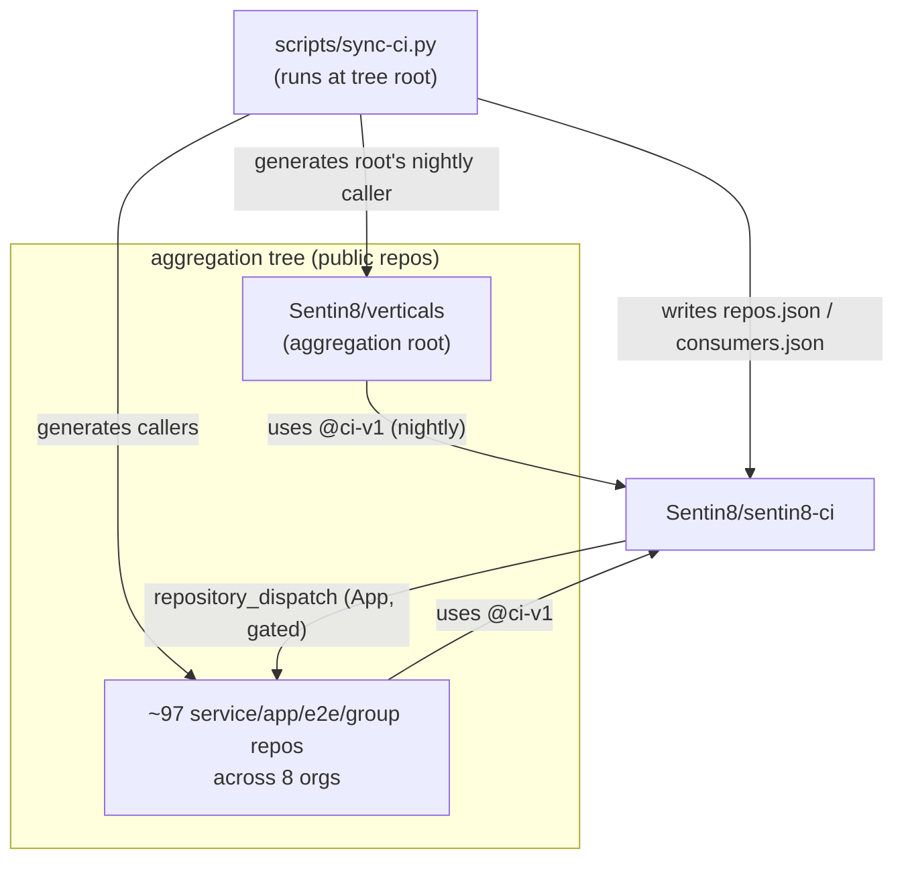
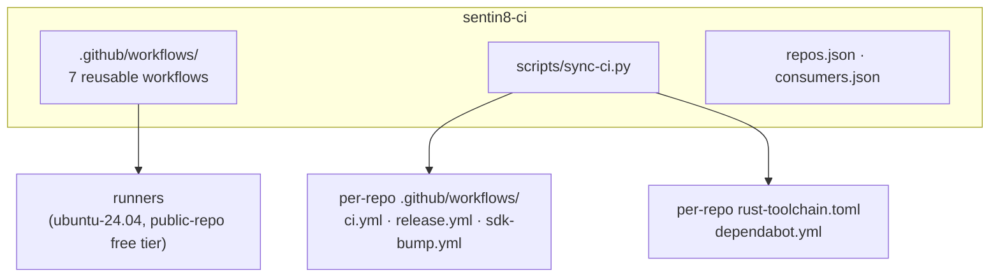
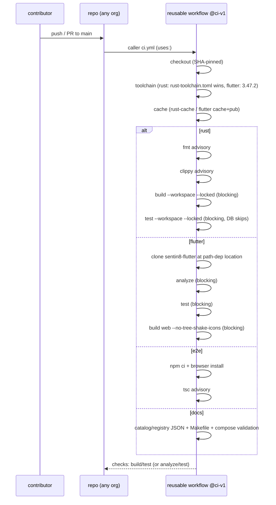
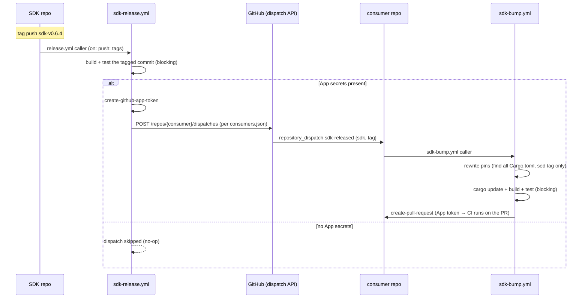
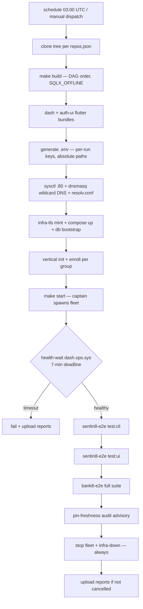
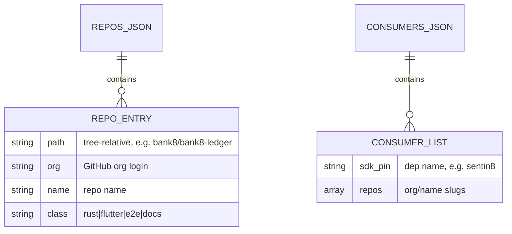
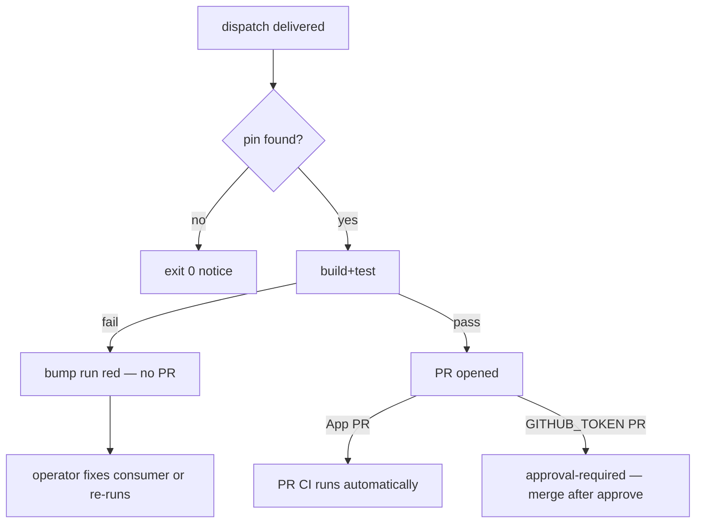
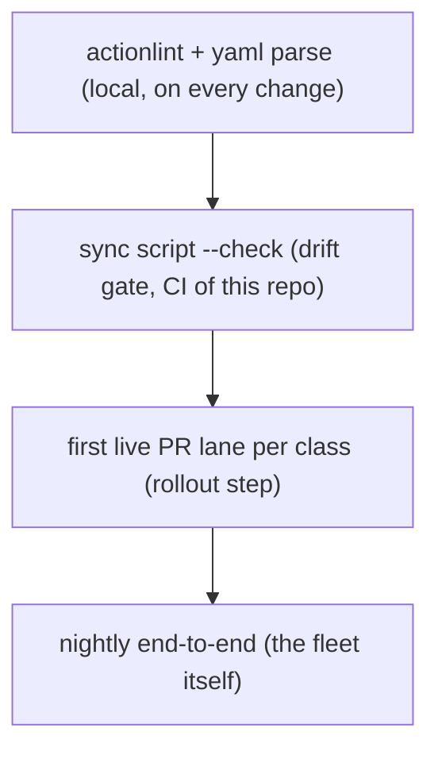

<!-- SPDX-FileCopyrightText: Copyright Logically Magic Inc. <hello@logicallymagic.com> -->
<!-- SPDX-FileCopyrightText: Copyright Hamid Jahanzad <Hamid@Jahanzad.com> -->
<!-- SPDX-FileCopyrightText: Copyright Contributors to the Sentin8:CI -->
<!-- SPDX-License-Identifier: Apache-2.0 -->

# DESIGN.md: Sentin8:CI — Detailed Design Document

> Audience: maintainers of the CI plane. Plan-of-record for the whole
> tree's CI/CD is `design/sentin8-ci-github-actions-design.md` in the
> aggregation root; this document covers this repository's own
> construction. For the overview read `README.md`; for functionality in
> business terms read `BUSINESS.md`.

## 1. Scope & Context

### 1.1 What this repo owns

* The tree's reusable GitHub Actions workflows (PR lanes per repo
  class, the SDK release + bump cascade, the aggregation nightly).
* The caller-generation script (`scripts/sync-ci.py`) and its outputs:
  per-repo caller workflows, `rust-toolchain.toml`, `dependabot.yml`.
* The manifests `repos.json` (tree clone map) and `consumers.json`
  (cascade fan-out map).
* The versioning contract of the workflows themselves (`ci-v1`).

### 1.2 What it does NOT own

* Any product code — build/test logic of the services lives in their
  repos; this repo only orchestrates it.
* The aggregation root's own workflow file (a thin caller in
  `Sentin8/verticals`) — generated by the sync script like any other.
* Branch-protection / org-settings configuration — those are GitHub
  org settings applied at rollout (backlog CICD-4), not files here.

### 1.3 System context



Trust boundary: the reusable workflows run with the **calling repo's**
`GITHUB_TOKEN` (permissions inherited and only reducible); the cascade
App token is minted per run and never persisted.

### 1.4 Container view



## 2. Runtime Architecture

### 2.1 PR lane (`rust.yml` / `flutter-app.yml` / `e2e-repo.yml` / `docs-group.yml`)



Failure branches: advisory steps use `continue-on-error: true` — they
report in the run but cannot fail it; blocking steps fail the job
immediately (single job per lane keeps the signal simple).

### 2.2 Release cascade (`sdk-release.yml` → `sdk-bump.yml`)



Failure branches: a dispatch failure on one consumer logs and
continues (best-effort per repo); a receiver that finds no pin of the
SDK exits 0 with a notice; a failing build in the receiver fails only
that consumer's bump run — no PR opens, the SDK release itself stays
green.

### 2.3 Aggregation nightly (`aggregation-nightly.yml`)



### 2.4 Sync script

Classifies by markers, parses pins, writes files. Its own failure mode
is safety: `--check` prints drift and exits 1 without writing;
non-git directories are never touched; a repo without an origin remote
is skipped entirely (not guessed).

## 3. Data Model



Generated per repo (not stored here): `.github/workflows/ci.yml`,
`.github/workflows/release.yml` (SDK repos), `.github/workflows/sdk-bump.yml`
(consumers), `rust-toolchain.toml` (Rust class), `.github/dependabot.yml`.

## 4. API Surface

### 4.1 Reusable workflow contracts (inputs)

| Workflow | Inputs | Secrets | Notes |
|---|---|---|---|
| `rust.yml` | `cache-key` (opt) | — | blocking build+test; advisory fmt/clippy |
| `flutter-app.yml` | `flutter-version` (3.47.2), `sentin8-flutter-path` (opt), `build-web` | — | blocking analyze/test/build |
| `e2e-repo.yml` | — | — | npm ci + browsers; advisory tsc |
| `docs-group.yml` | `has-compose` | — | JSON + Makefile + compose checks |
| `sdk-release.yml` | `sdk-name` (req) | `SENTIN8_CI_APP_ID`, `SENTIN8_CI_APP_PRIVATE_KEY` | gated fan-out |
| `sdk-bump.yml` | — | same App secrets | rewrites pins; opens PR |
| `aggregation-nightly.yml` | — | — | runs on the aggregation root's runner |

### 4.2 Sync script CLI

```
python3 sentin8-ci/scripts/sync-ci.py [--dry-run | --check]
```

Run from the aggregation tree root. Exits 2 outside the tree, 1 on
`--check` drift.

## 5. Cross-Cutting Concerns

* **Least privilege**: every workflow sets `permissions: contents:
  read`; the bump receiver raises to `contents: write +
  pull-requests: write` only for the PR step.
* **SHA pinning**: all third-party actions pinned to full commit SHAs;
  callers pin `@ci-v1`.
* **Cache hygiene**: `rust-cache` keys on lockfile + toolchain; Flutter
  action caches SDK + pub. Ad-hoc caches are never shared across jobs.
* **Injection safety**: dispatch payloads are read via `env:` into
  scripts, never interpolated into `run:` directly; sed patterns match
  the exact pin-line shape.
* **Idempotency**: the sync script rewrites only changed bytes; the
  bump receiver's sed + `cargo update` are idempotent on re-dispatch.

## 6. Failure Modes & Recovery



Nightly recovery: teardown steps run `if: always()`; report artifacts
upload `if: !cancelled()` so a failed run still produces evidence.

**Nightly disk budget (NIGHTLY-DISK-1).** The DAG build must keep the
runner inside its disk budget with all 100 repos present: after each
repo's `cargo build --release --locked`, the step prunes that repo's
compilation intermediates (`target/release/deps`, `target/release/build`,
`target/release/incremental`, `.fingerprint`) while KEEPING the final
binaries under `target/release` (captain's binary-prefix chain and the
e2e fixtures resolve binaries from there). The starter repos
(`sentin8-cli` — `make start-release` runs `cargo run --release`
through it, which rebuilds whatever is missing) are exempt. Release
profiles build with debuginfo off (`CARGO_PROFILE_RELEASE_DEBUG=0`),
and the step logs a `df -h /` checkpoint per repo so any future
pressure is diagnosable from the run log. Without pruning, ~90 cargo
workspaces' release artifacts exhaust the ~14 GB runner disk
(observed: ENOSPC at the platform-only stage, 2026-10-14 run
38640182055). A larger runner was rejected — the tree fits once
intermediates are pruned, and the standard runner keeps the nightly
on free minutes.

## 7. Concurrency & Performance Model

* PR lanes: one job per lane; `concurrency` group `ci-${{ ref }}` with
  cancel-in-progress keeps pushing branches cheap.
* Nightly: single job, 300-minute cap; heavy steps (build, suite) run
  sequentially to keep the fleet stable (the e2e suites are
  single-worker by design).
* Nightly DAG build: per-repo build-then-prune (see §6 disk budget) —
  intermediates never accumulate across the ~90-workspace sweep.
* Sync script: one pass over the tree, `rglob` bounded by `target/` /
  `node_modules/` exclusions.

## 8. Invariants

1. All workflows are `workflow_call`-callable with typed inputs; no
   hidden env contracts.
2. `SQLX_OFFLINE=true` on every cargo invocation in this repo's
   workflows.
3. No product secret names appear anywhere; only the two App secrets.
4. Runners are pinned (`ubuntu-24.04`) — never `ubuntu-latest`.
5. The manifests are regenerated by the same run that writes callers
   (they never diverge from the tree).
6. The nightly's DAG build prunes intermediates per repo — final
   binaries survive, `target/release/{deps,build,incremental}` and
   `.fingerprint` do not (NIGHTLY-DISK-1).

## 9. Testing Strategy



This repo's own CI runs actionlint-style validation + `sync-ci.py
--check` against a fixture tree; the workflows are validated for real
during the CICD-4 rollout (first callers pushed per class), and the
nightly validates the deepest integration (fleet boot + suites).

## 10. Open Questions

1. Runner memory ceiling for the full fleet + suites (16 GB) — first
   nightly run decides whether the fleet needs trimming.
2. Whether the bump receiver should auto-merge trivial pin bumps
   (currently PRs always wait for a human).
3. Where the sync script itself runs long-term (local operator
   workflow today; a scheduled CI job would need the tree).