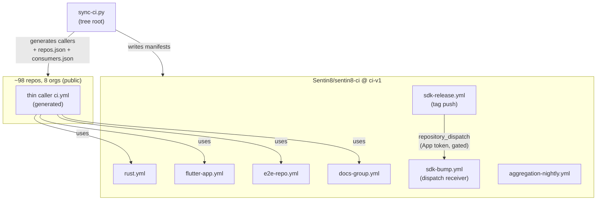

<!-- SPDX-FileCopyrightText: Copyright Logically Magic Inc. <hello@logicallymagic.com> -->
<!-- SPDX-FileCopyrightText: Copyright Hamid Jahanzad <Hamid@Jahanzad.com> -->
<!-- SPDX-FileCopyrightText: Copyright Contributors to the Sentin8:CI -->
<!-- SPDX-License-Identifier: Apache-2.0 -->

# README: Sentin8:CI — Tree-Wide Continuous Integration

## 1. Summary

`sentin8-ci` is the single public repository holding the GitHub Actions
pipelines for the whole Sentin8 repository tree (~98 repos across 8 GitHub
orgs). Every repository carries only a thin generated *caller workflow*
that delegates into one of this repo's *reusable workflows*; all pipeline
logic lives here, versioned under the `ci-v1` tag. A sync script
(`scripts/sync-ci.py`) generates the callers from the tree itself.

## 2. Motivation

The tree is a polyrepo by design (RS §2.1): platform services, six
vertical groups, SDK workspaces, and apps each live in their own
repository, connected by git-tag pinned Cargo dependencies. Without a
central CI authority, every repo would need a hand-maintained copy of the
same pipeline — 98 drifting copies. Reusable workflows from a **public**
repo are callable from any org, which makes this repo the one place where
the pipeline for every class (Rust service, Flutter app, Playwright e2e,
docs group) is defined, and the one tag (`ci-v1`) every repo pins.

## 3. Architecture & High-Level Design

The **PR lane** per repo class is fast and DB-free: build + test block
(DB-backed integration tests runtime-skip by the platform's testing
strategy); fmt/clippy/typecheck report advisories while the lint debt
exists, flipping to blocking via one input when the debt story lands.
The **nightly lane** (`aggregation-nightly.yml`, called by the
aggregation root `Sentin8/verticals`) is the only place the full fleet
boots: it clones the whole public tree, builds in DAG order, mints infra
TLS, bootstraps the platform database, starts the fleet under captain,
and runs the Playwright suites against it.

The **release lane** automates the SDK version ring (RS §7.1): an SDK
tag push triggers `sdk-release.yml`, which fans out a
`repository_dispatch` to every consumer repo in `consumers.json`; each
consumer's `sdk-bump.yml` receiver rewrites its pins, builds + tests,
and opens a pin-bump PR. The cascade is gated behind a GitHub App
installed in all orgs — until the operator creates it, the fan-out step
no-ops and the manual cascade keeps working.

## 4. Key Files & Data Structures

* **Reusable workflows** (`.github/workflows/*.yml`) — the callable
  pipelines, each `on: workflow_call`, actions pinned to commit SHAs,
  `permissions: contents: read`, runners pinned to `ubuntu-24.04`.
* **`scripts/sync-ci.py`** — the generator: classifies every repo by
  markers (Rust / Flutter / e2e / docs), parses all `Cargo.toml` git-tag
  pins to derive the SDK set + tag prefixes + consumer graph, writes
  each repo's callers (`ci.yml`, `release.yml`, `sdk-bump.yml`),
  `rust-toolchain.toml`, `dependabot.yml`, and regenerates this repo's
  manifests. Idempotent; `--check` is the drift gate.
* **`repos.json`** — one entry per repository: tree path, org, repo
  name, class. The nightly's tree-clone step walks it.
* **`consumers.json`** — SDK pin name → consumer repo slugs. The
  release fan-out reads it.

## 5. Rationale, Trade-offs, and Alternatives

* **Reusable workflows vs self-contained copies** — 98 hand-maintained
  copies drift (the exact disease CI exists to prevent); cross-org
  *private* reuse is impossible, but **public** reusable workflows are
  callable from every org — the single deciding constraint.
* **One version tag (`ci-v1`)** — all callers move in lockstep; a
  breaking input change is a major bump (`ci-v2`) with a rollout story,
  never a silent break.
* **Generated callers, never hand-edited** — the sync script is the
  only writer (`--check` in CI would catch a hand edit as drift).
* **Fast lane is DB-free** — the platform's DB-backed integration
  tests runtime-skip when PostgreSQL is unreachable; CI honors that
  contract and keeps PR minutes low. Full DB suites run in the nightly,
  which is free on public repos.
* **Advisory-then-blocking lint** — fmt drift (800–1000 files) and
  clippy backlog (78 errors in auth alone) predate CI; blocking
  immediately would make every repo red. Debt story CICD-5 flips the
  inputs.
* **`repository_dispatch`, not `workflow_dispatch`** — the cascade is
  event-driven with a payload (`{sdk, tag}`); receivers filter on
  `types: [sdk-released]` and run on their default branch.
* **GitHub App over PAT** — the fan-out needs cross-repo triggers
  (GITHUB_TOKEN cannot start runs) and PRs whose CI actually runs; an
  App scoped per org replaces long-lived PATs.

## 6. Internal Implementation & Invariants

* **CICD-1** No repo duplicates pipeline logic; logic changes ship in a
  new `ci-v1` tag.
* **CICD-2** CI needs no product secrets: public repos (anonymous
  fetch) + certificate identity (TLS minted per run) + generated dev
  keys. The only credentials are the optional cascade App secrets.
* **CICD-3** `SQLX_OFFLINE=true` on every compile; live-DB testing only
  in the aggregation nightly.
* **CICD-4** Blocking checks are honest: build/test block; lint
  advisories flip via a story, not a flag day.
* **CICD-5** The cascade never fires unauthenticated: no App secrets →
  the dispatch step is skipped, never half-run.
* **CICD-6** Caller files are generated, never hand-edited.
* Bulk tag pushes: >3 tags at once emit no events — release tags are
  pushed one at a time (documented operator rule).

## 7. Unresolved Questions / Future Designs

* Nightly tuning against a real runner (DNS quirks, fleet memory on
  16 GB, bootstrap timing) is expected — budget an iteration pass.
* ARM64 matrix leg (`ubuntu-24.04-arm`) once x86 nightly is green.
* Health8 repos appear as they are created — the sync script picks
  them up automatically.